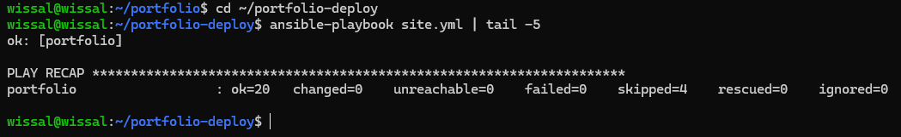
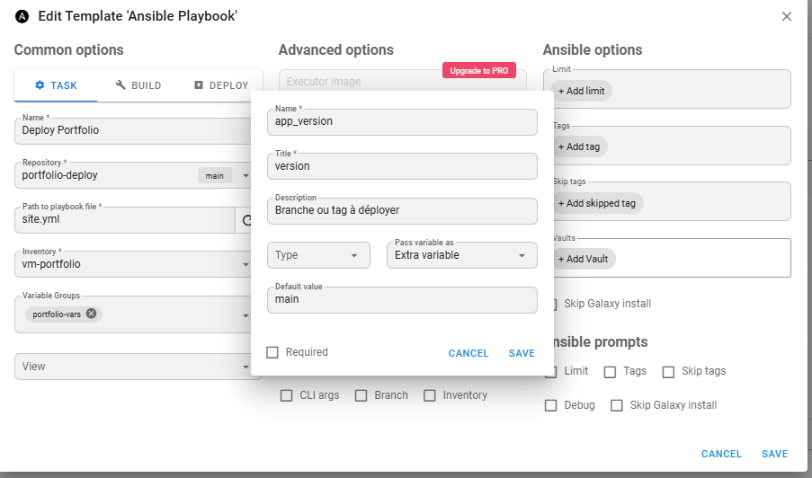
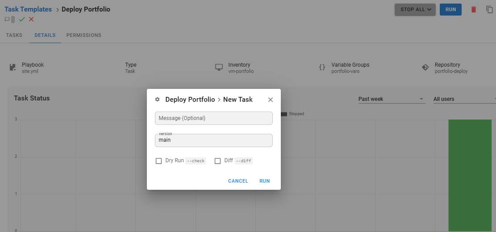
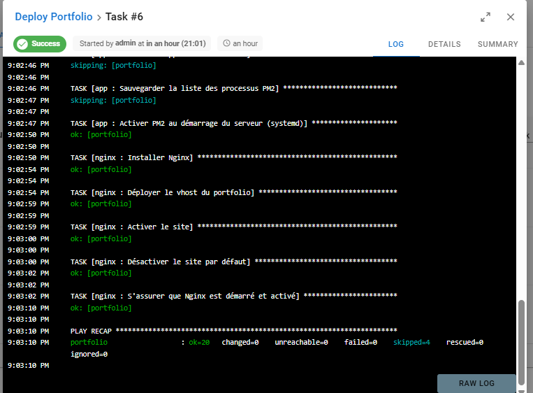
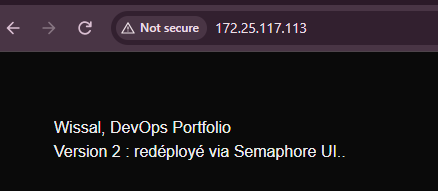

# portfolio-deploy

TP1 : déploiement d'un portfolio Next.js avec **Ansible** puis **Semaphore UI**.

Le serveur cible est une VM Ubuntu 24.04. Ansible y installe Node.js, lance l'application avec PM2 et configure Nginx en reverse proxy (port 80 → 3000).

## Architecture

```
Semaphore UI ──► clone ce dépôt ──► ansible-playbook site.yml ──► VM Ubuntu 24.04
                                                                   ├─ Node.js + PM2 (port 3000)
                                                                   └─ Nginx (port 80, reverse proxy)
```

## Structure

```
portfolio-deploy/
├── ansible.cfg
├── inventory/hosts.ini
├── group_vars/all.yml        # toutes les variables (aucune valeur en dur)
├── site.yml
└── roles/
    ├── common/               # paquets de base, utilisateur deploy
    ├── nodejs/               # dépôt NodeSource, Node.js, PM2
    ├── app/                  # git, npm ci, build, PM2 + handler de redémarrage
    └── nginx/                # vhost (template Jinja2) + handler de rechargement
```

## Utilisation en ligne de commande

1. `inventory/hosts.ini` : IP de la VM, utilisateur `deploy`.
2. `group_vars/all.yml` : `app_repo`, `app_version`, `server_name`, `app_port`.
3. Collection requise : `ansible-galaxy collection install community.general`

```bash
ansible all -m ping
ansible-playbook site.yml --syntax-check
ansible-playbook site.yml
ansible-playbook site.yml   # 2e run : changed=0
```

### Idempotence

`npm ci` et `npm run build` ne tournent que si le code a changé ou si aucun build n'existe. Le handler `Redémarrer l'application` n'est déclenché que par le build, et `Recharger Nginx` uniquement quand la configuration Nginx change.

Résultat du 2e run : `ok=20 changed=0 failed=0 skipped=4`.



## Industrialisation avec Semaphore UI

Semaphore tourne dans Docker (`docker-compose.semaphore.yml`, port 3001, base SQLite).

| Objet | Valeur |
|---|---|
| Projet | `portfolio-deploy` |
| Key Store | `ssh-vm-deploy` (clé SSH, utilisateur `deploy`), `none` (dépôt public) |
| Repository | ce dépôt, branche `main` |
| Inventory | `vm-portfolio` (statique, groupe `web`) |
| Variable Group | `portfolio-vars` : `{"server_name": "portfolio.local", "app_port": 3000}` |
| Task Template | `Deploy Portfolio` (playbook `site.yml`) |
| Survey Variable | `app_version` (extra variable, défaut `main`) |

Configuration du template :



Au lancement, Semaphore demande la version à déployer (branche ou tag) :



### Exécution réussie

Run Semaphore sans changement de code : `ok=20 changed=0 failed=0 skipped=4`.



### Portfolio déployé

Après modification de la page d'accueil, `git push`, puis relance de la tâche : le site affiche la nouvelle version.



## Livrables

- Rôles Ansible complétés (ce dépôt)
- Captures dans `captures/` : `semaphore-template.png`, `semaphore-run.png`, `portfolio.png`, `idempotence.png`
- Rapport : voir [`RAPPORT.md`](RAPPORT.md)
